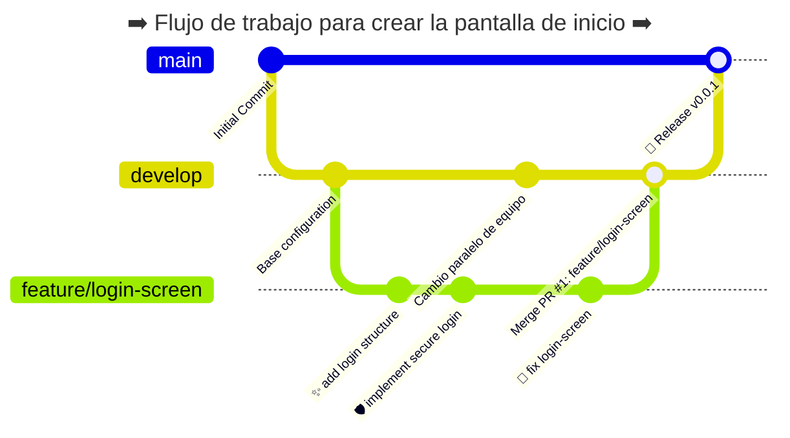

# GIT-Course

<p><code>Fundamentos de GIT</code></p>
<p>Creado por <code>GncDev</code> para explicar fundamentos de <code>Sistemas operativos</code>.</p>

## Comandos Git

Confirmar los cambios requiere agregar un mensaje corto y explicito que describa los cambios realizados al grupo de trabajo.

## Agenda

1. [Plataformas en la nube](#1-plataformas-en-la-nube).
1. [Protección y ciclo de vida](#2-protección-y-ciclo-de-vida).
1. [Estrategias de ramificación](#3-estrategias-de-ramificación).
1. [Integración y entrega continua - CI/CD](#4-integración-y-entrega-continua---cicd).

<br>

---

## 1. [Plataformas en la nube](#agenda)

- Son servicios web o plataformas en la nube.
- Almacenan repositorios de Git de forma centralizada.
- Requieren conexión a internet.
- Permiten acceder a tu código a través del navegador, interfaz gráfica o consola.

### 1.1. Servicios web mas populares ✔

| Característica              | [GitHub][11_1]          | [GitLab][11_2]      | [Bitbucket][11_3]          |
| :-------------------------- | :---------------------- | :------------------ | :------------------------- |
| Fundación                   | 2008                    | 2011                | 2008                       |
| Propietario                 | Microsoft               | GitLab              | Atlassian                  |
| Open Source                 | Núcleo privativo        | Community Edition   | Código privativo           |
| CI/CD Integrado             | GitHub Actions          | GitLab CI/CD nativo | Bitbucket Pipelines nativo |
| Entrada Precio/mes          | [4 - 21][11_4]          | [29][11_5]          | [3.65 - 8][11_6]           |
| Repositorios publico        | Sí, ilimitado           | Sí, ilimitado       | Sí, ilimitado              |
| Almacenamiento privado - RP | 1GB                     | 10GB                | 2GB                        |
| Minutos/mes de CI/CD en RP  | 2.000                   | 400                 | 50                         |
| Ideal para                  | Open Source, Personales | DevOps todo en uno  | Si usas Jira               |

[11_1]: https://es.wikipedia.org/wiki/GitHub
[11_2]: https://es.wikipedia.org/wiki/GitLab
[11_3]: https://es.wikipedia.org/wiki/Bitbucket
[11_4]: https://github.com/pricing
[11_5]: https://about.gitlab.com/es/pricing/
[11_6]: https://www.atlassian.com/software/bitbucket/pricing

### 1.2. Herramientas de GitHub ✔

- [GitHub CLI][12_1]: Consola (Windows, Linux, Mac)
- [GitHub Desktop][12_2]: Software de escritorio (Windows, Mac)
- [GitHub Repositories][12_3]: Gestionar repositorios en VSCode
- [GitHub Pull Requests][12_4]: Gestionar PR en VSCode
- [GitHub Actions][12_5]: Gestionar tus flujos de trabajo en VSCode
- [GitHub Codespaces][12_6]: Sincroniza entornos de desarrollo con VSCode
- [GitHub Copilot Chat][12_6]: Programación colaborativa con IA en VSCode

[12_1]: https://cli.github.com/
[12_2]: https://github.com/apps/desktop?locale=es-419
[12_3]: https://marketplace.visualstudio.com/items?itemName=GitHub.remotehub
[12_4]: https://marketplace.visualstudio.com/items?itemName=GitHub.vscode-pull-request-github
[12_5]: https://marketplace.visualstudio.com/items?itemName=GitHub.vscode-github-actions
[12_6]: https://marketplace.visualstudio.com/items?itemName=GitHub.codespaces

### 1.3. Otras Herramientas ✔

- [GitLab CLI][13_1]: Consola (Windows, Linux, Mac, BSD)
- [GitLab for VS Code][13_2]: Gestionar tus flujos de trabajo en VSCode
- [Sourcetree][13_3]: Software de escritorio (Windows, Mac)
- [Atlassian workspace for VS Code][13_4]: Gestionar tus flujos de trabajo en VSCode

[13_1]: https://gitlab.com/gitlab-org/cli/-/releases
[13_2]: https://marketplace.visualstudio.com/items?itemName=GitLab.gitlab-workflow
[13_3]: https://www.sourcetreeapp.com/download-archives
[13_4]: https://marketplace.visualstudio.com/items?itemName=Atlassian.atlascode

## 2. [Protección y ciclo de vida](#agenda)

### 2.1. Implicaciones de inyectar (Push) directamente en main ✔

- Graves **implicaciones** de trabajar directamente en `main`:
- **Introducción de errores:** Inyectar código directamente a `main` introduce errores.
- **Compilación fallida:** Trabajar en `main` puede romperlo.
- **Bloqueo del trabajo:** Un `main` roto bloquea a otros desarrolladores.
- **Sin revisión de código:** se pierde la oportunidad de que otros puedan revisar.
- **Historial Git Caótico:** Conflictos difíciles de rastrear.

### 2.2. Integración segura (Pull Requests) ✔

- El desarrollador trabaja localmente en una rama secundaria.
- El desarrollador comparte (`push`) los cambios a su rama.
- **Open Pull Requests:** el desarrollador tiene lista una funcionalidad la propone.
- **Review Pull Requests:** el equipo revisa y comenta el código.
- **Close Pull Requests:** EL líder acepta la propuesta.
- **Merge Pull Requests:** EL Mantenedor integra (`merge`) la propuesta a una rama principal.

### 2.3. Flujo de Trabajo en Git ✔



### 2.4. Reglas de oro para que la integración funcione mejor ✔

- La rama principal `main` es sagrada, protégela.
- Procura que la rama de desarrollo siempre este actualizada (`pull`).
- Evita tocar archivos fuera de tu responsabilidad.
- Usa todas las herramientas de protección de ramas que ofrece la plataforma.
- Crea una [plantilla para tus Pull Requests][24_1].

[24_1]: https://github.com/GiancarloBenavides/Git-Course/tree/master/41-Flujo-de-trabajo/pull_request_template.md

## 3. [Estrategias de ramificación](#agenda)

- Rama principal (**main**/**master**): El software listo y estable para el usuario final.
- Rama de integración (**develop**): El punto de encuentro de las nuevas funciones en desarrollo.
- Ramas de soporte (**<_prefijo_>/<_característica_>**): con prefijos que indican la tarea soportada.
- Las ramas main y develop, las ramas de soporte son de vida corta.

### 3.1. Prefijos comunes en la industria ✔

- Funcionalidades nuevas: (**feature/<_característica_>**). Ej: _feature/login-screen_
- Corrección de errores (**bugfix/<_nombre-error_>**). Ej: bugfix/fix-login-button
- Errores críticos (**hotfix/<_nombre-error_>**). Ej: bugfix/crash-on-checkout

### 3.2. Modelos populares que el arquitecto suele elegir ✔

- [GitFlow][32_1]: diseñado por [Vincent Driessen][32_2] en 2010.
- GitFlow es un modelo complejo enfocado en [versioned releases][32_3].
- [GitHub Flow][32_4]: diseñado por GitHub en 2011.
- GitHub Flow es un modelo simple enfocado en [continuous delivery][32_5].
- [GitLab Flow][32_6]: diseñado por GitLab en 2014.
- GitLab Flow añade ramas para entornos a GitFlow.
- Cualquier flujo se puede usar en [GitHub][32_7], [GitLab][32_8] o [Bitbucket][32_9].

[32_1]: https://about.gitlab.com/blog/what-is-gitflow/
[32_2]: https://nvie.com/posts/a-successful-git-branching-model/
[32_3]: https://es.wikipedia.org/wiki/Release_Management
[32_4]: https://docs.github.com/en/get-started/using-github/github-flow
[32_5]: https://es.wikipedia.org/wiki/Entrega_continua
[32_6]: https://about.gitlab.com/es/topics/version-control/what-is-gitlab-flow/
[32_7]: https://github.com/
[32_8]: https://about.gitlab.com/es/
[32_9]: https://bitbucket.org/product/

### 3.3. Tabla Comparativa: GitFlow vs GitHub Flow ✔

| Característica           | GitFlow                                         | GitHub Flow                                  |
| :----------------------- | :---------------------------------------------- | :------------------------------------------- |
| Ramas principales        | `main` `develop` (producción y desarrollo)      | Únicamente `main`                            |
| Ramas de soporte         | `feature/*`, `release/*`, `hotfix/*`            | `feature/*` de vida corta                    |
| Complejidad              | `Alta`; protocolo estricto                      | `Baja`; simple y ligera                      |
| Ciclo de lanzamientos    | versioned releases                              | Continuous Delivery                          |
| Corrección en producción | Mediante ramas `hotfix/*` desde `main`          | directamente desde `main`                    |
| Ideal para               | Equipos grandes y [Waterfall development][33_1] | Equipos pequeños y [Agile development][33_2] |

[33_1]: https://es.wikipedia.org/wiki/Desarrollo_en_cascada
[33_2]: https://es.wikipedia.org/wiki/Desarrollo_%C3%A1gil_de_software

### 3.4. Ejemplo de comandos empleados en local - antes del Pull Requests ✔

```bash
# Para crear y moverte a una nueva rama secundaria
git switch -c feature/login-screen
# Para agregar cambios a esta nueva rama secundaria
git add .
git commit -m "✨ add new login-screen"
git push origin feature/login-screen
# Para actualizar la rama secundaria desde la principal
git pull origin main
# Para agregar mas cambios a esta nueva rama secundaria
git add .
git commit -m "🐞 fix login-screen"
git push
```

### 3.5. Ejemplo de comandos empleados para solicitar Pull Requests ✔

```bash
# Para crear una nueva Pull Requests desde consola usando GitHub CLI
gh pr create --title "Título de tu PR" \
             --body "Descripción detallada de los cambios" \
             --base develop \                                       # Especifica la rama de destino
             --draft \                                              # Crea la PR en modo borrador
             --web                                                  # Abre la PR en tu navegador web tras crearla

# Para agregar fusionar cambios a la rama principal después de la PR
git switch main
git merge feature/login-screen
```

## 4. [Integración y entrega continua - CI/CD](#agenda)

- Proceso de despliegue sencillo y repetible.
- Combina [integración continua][4_1], [entrega continua][4_2] y/o [Despliegue continuo][4_3].
- Apoyado en herramientas que ofrecen servicios de pruebas automatizadas.
- Mejora la detección temprana de defectos.
- Mejora la velocidad de liberación y la productividad.
- Mejora la satisfacción del cliente.

[4_1]: https://es.wikipedia.org/wiki/Integraci%C3%B3n_continua
[4_2]: https://es.wikipedia.org/wiki/Entrega_continua
[4_3]: https://en.wikipedia.org/wiki/Continuous_deployment

### 4.1. ¿Como se hace? ✔

- Agrega las **pruebas automáticas de código** (Lint, check y vitest).
- Activa las pruebas cuando se envíe código **Push** hacia las ramas principales.
- Activa las pruebas cuando se solicite un **Pull Request** hacia la rama main.

### 4.2. GitHub Actions ✔

- En github se usa un [archivo yaml][42_1] para configurar el flujo de trabajo.
- El **flujo** se agrega a la carpeta .github/workflows/
- **GitHub Actions** ejecutará este flujo automáticamente

[42_1]: https://github.com/GiancarloBenavides/Git-Course/tree/master/41-Flujo-de-trabajo/ci.deploy.yml

---

## Mas Recursos

- [Ramificación](<https://en.wikipedia.org/wiki/Branching_(version_control)>) (Wikipedia)
- [Estrategias de creación de ramas](https://www.atlassian.com/es/agile/software-development/branching) (Atlassian)
- [Ruleset](https://docs.github.com/es/repositories/configuring-branches-and-merges-in-your-repository/managing-rulesets/about-rulesets) (GitHub)
- [Proteger ramas](https://docs.github.com/es/repositories/configuring-branches-and-merges-in-your-repository/managing-protected-branches/managing-a-branch-protection-rule) (GitHub)
